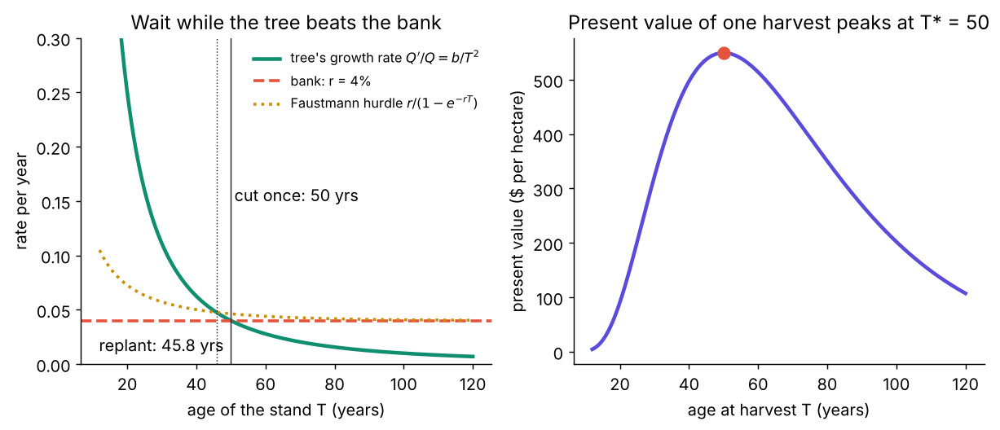
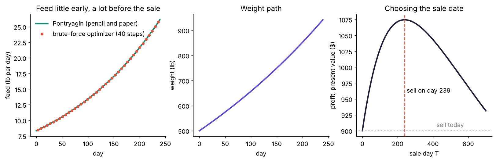
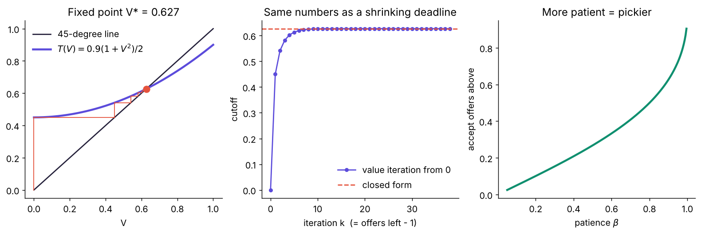
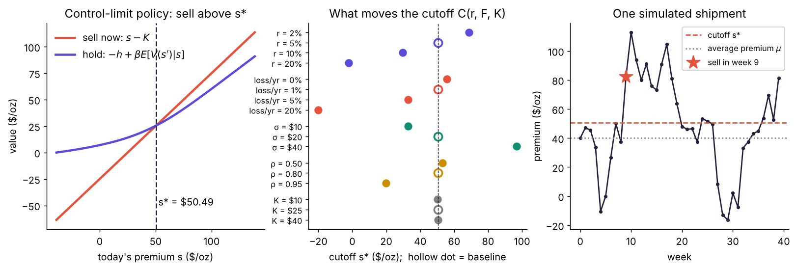

# Optimal Control, From Zero

**QMB 6875 Stochastic Methods · Presentation 1 of 3 · Allie McCutcheon · Fall 2026**

> **The whole subject is one question:** *What should I do **now**, knowing that today's choice changes **tomorrow**?*

This repository teaches **optimal control**, deterministic and stochastic, to someone who has never seen it. It uses four problems, each a little harder than the last. Every answer is derived by hand **and** checked by an independent computer calculation (24 automated tests), so nothing has to be taken on faith.

The examples come straight from the October 29 class: the professor's **tree-harvesting** rule, his first research project (**feeding a heifer**), and the **gold trader** capstone with its control-limit policy $C(r, F_\varepsilon, K)$.

| Companion repos | |
|---|---|
| **1. Optimal control** (this repo) | the rules are known → solve them with math |
| 2. `qmb6875-2-reinforcement-learning` | the rules are unknown → learn by trying |
| 3. `qmb6875-3-on-a-computer` | how to actually get the numbers out, and how to trust them |

---

## The four problems and their answers

| # | Problem | Randomness? | Method | Answer |
|---|---------|:-----------:|--------|--------|
| 1 | **When to cut a tree** | no | calculus: growth rate = interest rate | cut at **50 years** (45.8 if you replant) |
| 2 | **How to feed a heifer, and when to sell her** | no | Pontryagin's maximum principle | feed **8.3 → 26.1 lb/day**, sell on **day 239** at **942 lb**; profit **$1,074.51** vs $900 selling today |
| 3 | **Which offer to accept** | yes | Bellman equation, closed form | accept any offer **≥ 0.627** |
| 4 | **When the gold trader should ship** | yes | Bellman equation, solved on a computer | ship once the premium is **≥ $50.49/oz** |

Every number in this README is written by `scripts/make_figures.py` into [`results/results.json`](results/results.json). None of them were typed by hand.

### 1. The tree: *wait while the tree grows faster than money in the bank*



Volume $Q(T)=e^{a-b/T}$ grows at the rate $Q'/Q=b/T^2$, which falls with age. Cutting at $T$ is worth $p\,Q(T)e^{-rT}$. Maximizing gives

$$\frac{Q'(T)}{Q(T)}=r\quad\Longrightarrow\quad T^*=\sqrt{b/r}=\sqrt{100/0.04}=50\text{ years}.$$

If the land is replanted forever (the **Faustmann** rule), every year of waiting also delays all future crops, so you cut sooner: **45.8 years**.

### 2. The heifer: *give every pound a price, then feed until a scoop costs what it adds*



The choice is now a **whole plan** $f(t)$, not one number. Pontryagin's principle puts a price $\lambda(t)$ on each pound of weight (its *shadow value*), and the answer is

$$f^*(t)=\Big(\frac{a\,p}{2c}\Big)^2 e^{-2(r+m)(T-t)}.$$

So you **feed lightly early and heavily just before the sale**. That is what real cattle feeders do: cheap "backgrounding," then a "finishing" ration. A 40-variable optimizer that knows no calculus finds the same plan to within **0.0004 lb/day** (red dots above). The best sale date is **day 239** (about 7.9 months).

### 3. The offer problem: *the simplest stochastic control problem*



An offer $w\sim U(0,1)$ arrives each period. Accept and you're paid; reject and you wait ($\beta=0.9$). The value of waiting solves

$$V=\beta\,E[\max(w,V)]=\beta\,\frac{1+V^2}{2}\quad\Longrightarrow\quad V^*=\frac{1-\sqrt{1-\beta^2}}{\beta}=0.627.$$

**Accept any offer of at least 0.627.** A single cutoff like this is called a **control-limit policy**. Value iteration started at zero produces *exactly* the cutoffs you would use with 1, 2, 3, … offers left before a deadline (middle panel).

### 4. The gold trader: *a control-limit policy you can only get on a computer*



The New York premium $s$ on an ounce follows an AR(1). Selling pays $s-K$. Holding costs $h=\$2.89$ per week (interest on the $2,500 tied up plus the risk of loss). The Bellman equation

$$V(s)=\max\{\,s-K,\;-h+\beta\,E[V(s')\mid s]\,\}$$

has no pencil-and-paper solution, so we discretize $s$ (Tauchen's method) and run value iteration. **Ship once the premium reaches $50.49/oz.**

The middle panel is the professor's $C(r,F_\varepsilon,K)$:
- Costlier money ($r$) or riskier holding → ship **sooner**.
- Bigger price swings ($\sigma$) → wait for a **better** premium.
- The one-time shipping cost $K$ barely matters, because you pay it whenever you sell. ([why?](docs/FAQ.md#gold))

In 20,000 simulated shipments, the optimal rule earns **$26.59/oz** (95% interval ± $0.40), versus **$14.86** for selling immediately and **$4.04** for being too picky.

---

## How to run it

```bash
git clone https://github.com/<your-username>/qmb6875-1-optimal-control.git
cd qmb6875-1-optimal-control
pip install -e .                # installs the optcontrol package + numpy/scipy/matplotlib
pip install pytest

pytest                          # 24 tests: every formula checked by computer
python scripts/make_figures.py  # rebuilds figures/ and results/results.json
python -m optcontrol.gold       # any module also runs on its own
```

**No install at all?** Open [`notebooks/walkthrough.ipynb`](notebooks/walkthrough.ipynb). It is saved with its outputs, so GitHub shows every number and plot without running anything. To run it in **Google Colab**: File → Open notebook → GitHub tab → paste this repo's URL.

Requires Python 3.10+, NumPy 2.x, SciPy, Matplotlib (see [`requirements.txt`](requirements.txt)).

## What's in the repo

```
README.md                ← you are here: the 5-minute version
docs/
  THEORY.md              ← the full lesson, from zero, with every derivation
  DECISIONS.md           ← every modeling and coding choice, why I made it, and what I rejected
  FAQ.md                 ← questions the professor is likely to ask, answered
  GLOSSARY.md            ← every term in plain English
  PRESENTING.md          ← how to present this in 15 minutes (and in 60 seconds if cold-called)
src/optcontrol/
  tree.py                ← Problem 1: Fisher and Faustmann rotations
  heifer.py              ← Problem 2: Pontryagin closed form + brute-force check
  offer.py               ← Problem 3: closed form, value iteration, finite deadline, simulation
  gold.py                ← Problem 4: Tauchen grid, value iteration, comparative statics, simulation
tests/test_optcontrol.py ← 24 tests (closed form vs computer, every time)
scripts/make_figures.py  ← regenerates every figure and number
notebooks/walkthrough.ipynb
figures/  results/
```

## Read in this order

1. This README (5 minutes).
2. [`docs/GLOSSARY.md`](docs/GLOSSARY.md) if a word is unfamiliar.
3. [`docs/THEORY.md`](docs/THEORY.md): the full lesson, about 30 minutes.
4. [`docs/DECISIONS.md`](docs/DECISIONS.md) and [`docs/FAQ.md`](docs/FAQ.md) before presenting.
5. The notebook, to see each number appear.

## Honest limitations

- **The parameters are illustrative.** They are calibrated to be realistic (heifer weights, feed intake, interest rates), not estimated from data. [`docs/DECISIONS.md`](docs/DECISIONS.md) gives the source of every number.
- **Risk neutrality.** Every decision maker maximizes *expected* present value. A risk-averse gold trader would ship sooner (FAQ).
- **One decision maker.** Nobody else's choices react to yours; prices are taken from the market.
- **The heifer problem is deterministic.** Adding noise to her growth is done in repo 3 (Monte Carlo simulation of a stochastic differential equation).

## References

- Kamien, M. & Schwartz, N. *Dynamic Optimization* (2nd ed., 1991): Pontryagin's principle, the Hamiltonian, sufficiency.
- Stokey, N. & Lucas, R. *Recursive Methods in Economic Dynamics* (1989): Bellman equations and contraction mappings.
- Ljungqvist, L. & Sargent, T. *Recursive Macroeconomic Theory*: the McCall job-search (offer) model.
- Faustmann, M. (1849): the forestry rotation formula; Fisher (1930) for the single-rotation rule.
- Tauchen, G. (1986), "Finite state Markov-chain approximations to univariate and vector autoregressions," *Economics Letters* 20: 177–181.
